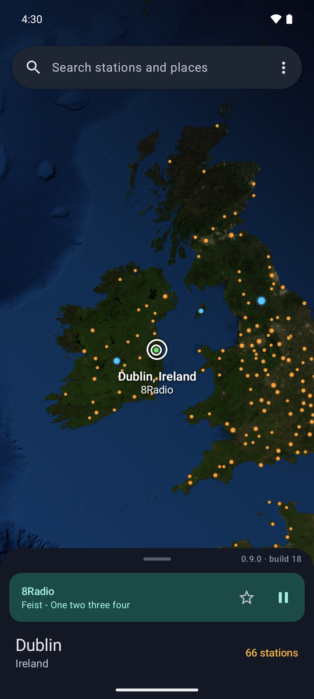

# Ensō Radio for Android

Ensō Radio is a radio explorer: spin the globe, hold the ring over a place,
and hear what's on air there. It's a player for internet radio streams, with
a station list that is yours to keep and edit.

<p align="center"></p>

**0.9.1 is a beta.** So far it has been tested on a Samsung Galaxy S25 Ultra
(Android 17) and the Android emulator. Please report problems as GitHub
issues.

Ensō Radio started on the PS Vita
([hiraethsystems/Enso-Radio-Vita](https://github.com/hiraethsystems/Enso-Radio-Vita),
frozen) and then came to the Linux desktop
([hiraethsystems/Enso-Radio-Linux](https://github.com/hiraethsystems/Enso-Radio-Linux)).
This repository was split from the Linux one with its history, and keeps the
shared portable C code in `core/`. The apps share a station-file format but
are developed and released separately.

## What it does

- A globe from NASA's satellite imagery, with a moving day and night side and
  city lights at night. Drag to spin it, pinch or double-tap to zoom.
- Hold a place under the ring and it plays. Search for stations and places,
  browse by country or genre, keep favourites, and go back to recent
  stations.
- Plays MP3, AAC and HE-AAC, Ogg Vorbis, Opus and FLAC, and HLS streams.
  Shows the song playing when the station sends it.
- Keeps playing in the background and with the screen off, with controls in
  the notification, on the lock screen, and on headphones and Bluetooth.
  Pauses for phone calls. A sleep timer is in Now Playing.
- About 51,000 stations included: a snapshot of
  [Radio Browser](https://www.radio-browser.info), a community station
  directory, from 22 November 2026. Stations change address and close, so
  keeping your list up to date is up to you. The app never downloads
  anything you didn't ask for.
- No Google Play Services, no analytics, no ads, no account.

## Installing

Download the APK from [Releases](https://github.com/hiraethsystems/Enso-Radio/releases)
and open it on your phone (Android asks you to allow your browser or file
manager to install apps). It needs **Android 13 or later** on a 64-bit ARM
phone or tablet, which is nearly all of them since 2019.

The APK is about 120 MB, most of it the globe's imagery. For the sharpest
view when you zoom in close, Settings > Globe > Full detail downloads the
closest zoom level (254 MB) from this repository's releases. It's only
downloaded when you ask, checked before it's used, and can be removed again
in the same place.

## Your files

Your station list (`stations.txt`), favourites and recent stations are in
`Android/data/systems.hiraeth.ensoradio/files/` on the phone's storage, where
a computer can reach them over USB. The app copies its included list there
the first time it starts and never overwrites it afterwards, so your edits
are kept. Android deletes that folder when the app is uninstalled, so copy
your files off first.

**Updating from 0.9.0:** 0.9.0 had a different app ID
(`systems.hiraeth.dxgarden`), so this version installs as a new app beside
it rather than over it, and Android doesn't let one app read another's
folder. If you changed `stations.txt` or have favourites, copy
`Android/data/systems.hiraeth.dxgarden/files/` over USB into
`Android/data/systems.hiraeth.ensoradio/files/` (start the new version once
first so the folder exists), then uninstall 0.9.0.

## Not yet

- Adding a station by its address, opening M3U and PLS playlists with Ensō
  Radio, and Download Station List (a fresh list from Radio Browser, when
  you ask). For now, edit `stations.txt` from a computer.
- F-Droid. Releases are here on GitHub for now.

Progress and design decisions are in `NOTES.md`.

## Building

Everything builds from the command line on Linux, without Android Studio:
the Android SDK command-line tools, NDK 28.2.13676358, the Gradle wrapper and
JDK 21. `NOTES.md` (A0) has the exact versions, and the "Building" section of
the Android notes has the steps. The globe imagery is made by
`tools/make_earth.py --detail-from 6` (the APK's packs in `build-earth/`,
the full-detail download in `build-earth-detail/`) and the native libraries by
`tools/build_android_deps.sh`.

## Tests

`core/` (station files, playlists, streams, the station-list builder) has
unit tests that need only a C compiler and zlib:

```sh
cmake -S . -B build-test -DENSO_APP=OFF && cmake --build build-test && ./build-test/ensoradio_test
python3 -I tools/test_rb_to_stations.py
```

`tests/compare_listtool.sh` checks that the app's list builder
(`core/rb_build.c`) writes the same list as `tools/rb_to_stations.py`.

## Credits and licences

- Ensō Radio is licensed under the GNU GPL v3 (see `LICENSE`).
- Linked into the app: SDL3 (zlib licence), libcurl (curl licence),
  Mbed TLS (Apache 2.0), mpg123 (LGPL 2.1), faad2 (GPL 2 or later),
  libogg, libvorbis, Opus, opusfile and libFLAC (BSD), FreeType (FreeType
  licence), HarfBuzz (MIT), FriBidi (LGPL 2.1), zlib (zlib licence) and
  stb_image (public domain or MIT).
- The interface uses Jetpack Compose and Material 3 (AndroidX, Apache 2.0),
  and a few of Google's Material Icons (Apache 2.0).
- Unicode tables made from the Unicode Character Database (Unicode
  licence).
- Fonts: Liberation Sans, and Noto Sans, Noto Sans Arabic, Hebrew, Thai,
  Georgian and Ethiopic, and a subset of Noto Sans CJK SC made by
  `tools/make_fonts.py`; all SIL Open Font License 1.1
  (`assets/fonts/OFL.txt`, `assets/fonts/OFL-Liberation.txt`).
- Globe imagery from NASA: Blue Marble: Next Generation (Reto Stöckli,
  NASA Earth Observatory) for the day side, and Black Marble 2016 (NASA
  Earth Observatory images by Joshua Stevens, using Suomi NPP VIIRS data
  from Miguel Román, NASA Goddard Space Flight Center) for the night side.
  NASA imagery is not under copyright in the US; its use here implies no
  endorsement by NASA. `tools/make_earth.py` downloads the source images
  and builds the app's tile packs.
- Station lists made with `tools/rb_to_stations.py`, and lists the app
  downloads, come from Radio Browser (radio-browser.info), whose API
  documentation says it may be used in free and non-free software and its
  data mirrored. Town and region names come from GeoNames (geonames.org),
  licensed CC BY 4.0. Positions are checked against Natural Earth country
  shapes (public domain). GeoNames' `cities1000.zip` and
  `admin1CodesASCII.txt` (from download.geonames.org) and Natural Earth's
  `ne_50m_admin_0_countries.geojson` (v5.1.2, from the natural-earth-vector
  repository on GitHub) are downloaded only when you ask for a list.
